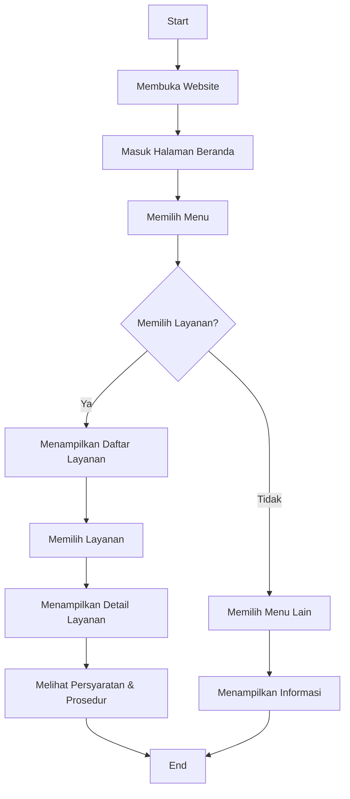
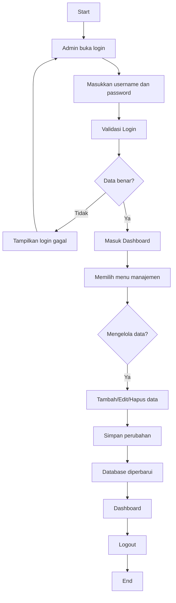
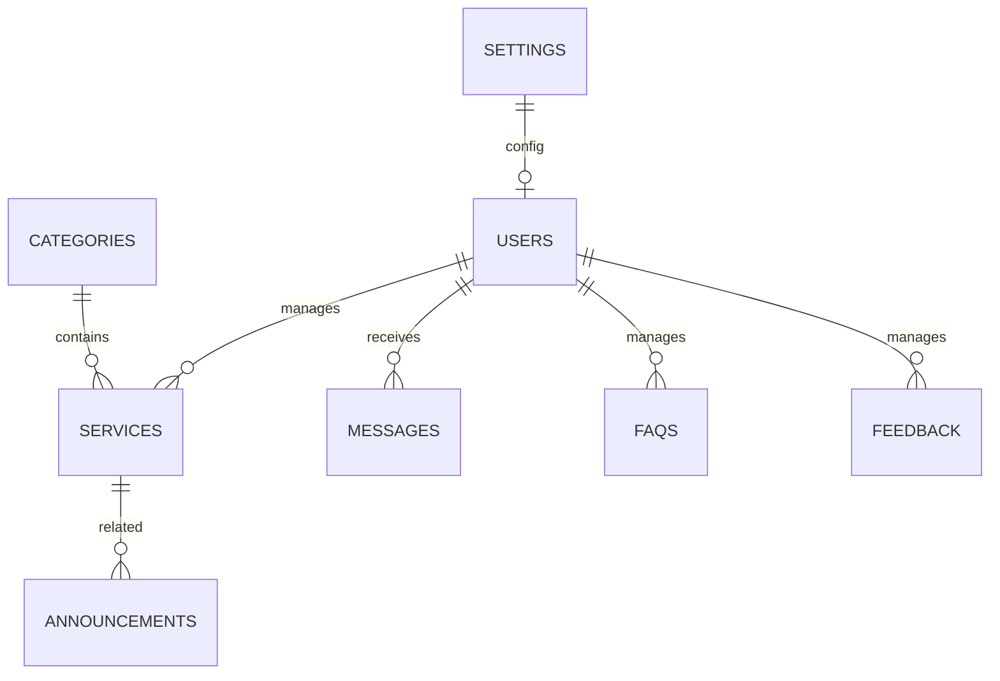

# Analisis Sistem

## Tujuan Sistem
- Menyediakan informasi pelayanan perbankan secara digital.
- Memudahkan masyarakat mengakses layanan, persyaratan, dan jadwal operasional.
- Mengurangi komunikasi manual serta meningkatkan efisiensi pelayanan.

## Identifikasi Pengguna
### Pengunjung/Masyarakat
- Melihat layanan
- Mencari informasi
- Mengirim pertanyaan dan feedback

### Administrator
- Login ke dashboard
- Mengelola layanan, kategori, pengumuman, FAQ, pesan, dan pengaturan

## Fitur Utama
- Public website
- Search dan filter layanan
- FAQ accordion
- Form kontak dan feedback
- Dashboard admin
- CRUD data

## Use Case
```text
Pengunjung -> Website -> Lihat layanan -> Detail layanan -> Informasi dan persyaratan
Pengunjung -> Kontak -> Kirim pesan -> Admin menerima pesan
Admin -> Login -> Dashboard -> Kelola data -> Simpan ke database
```

## Flowchart Pengunjung


## Flowchart Administrator


## ERD Database


## Struktur Folder
- app/
- blueprints/
- models/
- templates/
- static/
- config.py
- run.py
